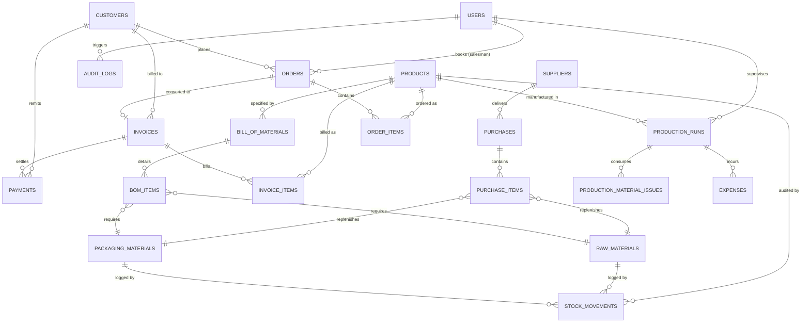

# SYSTEM DESIGN NOTE & DATABASE ER SPECIFICATION
## Order-to-Audit ERP for Packaged Food Manufacturing
**Institution**: Centre for Digital Infrastructure, NIT Tiruchirappalli  
**Application Type**: Integrated Multi-Module Food Manufacturing ERP  
**Product Focus**: Murukku 200g, Mixture, Chips, and Sweets  

---

### 1. Architectural Philosophy & Core Decisions

In small to medium-scale packaged food manufacturing, the core failure mode of generic billing or inventory software is **the absence of an immutable transaction ledger**. Generic software allows users to manually edit stock numbers in the database, masking production spoilage, theft, packaging damage, and unrecorded yield loss.

This ERP enforces three architectural invariants:

1. **Transaction-Based Stock Immutability**:
   Stock balances on `raw_materials`, `packaging_materials`, and `products` are never directly overwritten. Every mutation requires a typed, audited `StockMovement` row tied to a source document:
   - `purchase` (Supplier invoice)
   - `production_issue` (BOM material requisition)
   - `production_receipt` (Good output packet receipt)
   - `dispatch` (Outward customer tax invoice)
   - `credit_note` / `cancellation` (Audit reversal)

2. **Automated Production Variance & Yield Alerting**:
   Traditional systems calculate recipe costs based purely on theoretical standards. In food manufacturing, human error in dough mixing, frying temperature fluctuations, and oil absorption cause significant yield shifts.
   This system dynamically calculates:
   $$\text{Yield Variance \%} = \frac{\text{Actual Good Packets} - \text{Planned Standard Packets}}{\text{Planned Standard Packets}} \times 100$$
   $$\text{Material Variance \%} = \frac{\text{Actual Material Consumed} - \text{BOM Standard Material}}{\text{BOM Standard Material}} \times 100$$
   If the absolute deviation exceeds **3.0%**, the system flags the batch with a persistent `is_variance_alert = 1` for management and audit inspection.

3. **Weighted-Average Inventory Valuation (WAC)**:
   Raw material prices fluctuate constantly (e.g. flour rising from ₹42.00 to ₹45.00/kg). The system updates unit inventory values using the weighted-average method upon each purchase:
   $$WAC_{\text{new}} = \frac{(Q_{\text{existing}} \times WAC_{\text{existing}}) + (Q_{\text{purchased}} \times \text{Cost}_{\text{purchased}})}{Q_{\text{existing}} + Q_{\text{purchased}}}$$
   For the benchmark run:
   - Opening: 100 kg @ ₹42.00 = ₹4,200.00
   - Inward PO: 60 kg @ ₹45.00 = ₹2,700.00
   - Result: 160 kg total @ $\frac{6,900}{160} = \mathbf{₹43.125/\text{kg}}$.

---

### 2. Relational Database Entity-Relationship (ER) Diagram

---

### 3. GST Calculation & Statutory Compliance Engine

The company is registered under Tamil Nadu GST rules:
- **Supplier State**: Tamil Nadu (State Code: `33`)
- **GSTIN**: `33AABCS9876Q1Z2`
- **Product HSN Code**: `21069099` (Murukku & edible savouries)
- **Applicable GST Rate**: $5.0\%$

#### Rule A: Intrastate Billing (Tamil Nadu to Tamil Nadu)
- Split equally into:
  - **CGST (Central Tax)**: $2.5\%$
  - **SGST (State Tax)**: $2.5\%$
- *Benchmark Case (Retailer A)*:
  - 150 packets @ ₹50.00 pre-tax = ₹7,500.00 Taxable Value.
  - CGST: $7500 \times 2.5\% = \mathbf{₹187.50}$
  - SGST: $7500 \times 2.5\% = \mathbf{₹187.50}$
  - Total Invoice: $7500 + 187.50 + 187.50 = \mathbf{₹7,875.00}$
  - Payment Received: ₹4,000.00
  - Net Outstanding Balance: $\mathbf{₹3,875.00}$

#### Rule B: Interstate Billing (Tamil Nadu to Karnataka)
- Applied as:
  - **IGST (Integrated Tax)**: $5.0\%$
- *Benchmark Case (Distributor B in Bengaluru, KA - State Code: `29`)*:
  - Taxable Rate: ₹50.00 / packet
  - IGST: 5.0%
  - Stock Check Mechanism: Warehouse has 88 packets remaining after Retailer A dispatch. Distributor B requests 120 packets. The system flags an automatic shortage of **32 packets**.

---

### 4. Batch Costing & Absorption Unit Economics

Total manufacturing cost per production batch is computed by absorbing all direct materials, direct labour, and energy overheads:

$$\text{Total Cost} = \text{RM Cost} + \text{Packaging Cost} + \text{Direct Labour} + \text{Commercial Power/Fuel}$$

$$\text{Cost Per Good Packet} = \frac{\text{Total Cost}}{\text{Good Packets Output}}$$

$$\text{Gross Margin} = \text{Selling Price} - \text{Cost Per Good Packet}$$

$$\text{Gross Margin \%} = \frac{\text{Gross Margin}}{\text{Selling Price}} \times 100$$

#### Numerical Validation (Batch 1 - Murukku 200g):
1. **Flour**: 40 kg issued @ weighted cost ₹43.125 = ₹1,725.00
2. **Cooking Oil**: 10.5 L issued @ ₹140.00 = ₹1,470.00
3. **Salt & Spice Mix**: 1.2 kg issued @ ₹200.00 = ₹240.00
4. **200g Pouches**: 188 good + 6 damaged = 194 pouches @ ₹2.50 = ₹485.00
5. **Cartons**: 9 cartons @ ₹15.00 = ₹135.00
6. **Direct Labour**: ₹1,200.00
7. **Commercial Power & Gas**: ₹600.00
- **Total Batch Cost** = $1725 + 1470 + 240 + 485 + 135 + 1200 + 600 = \mathbf{₹5,855.00}$
- **Actual Good Output** = 188 packets
- **Cost Per Good Packet** = $\frac{5855}{188} = \mathbf{₹31.14}$
- **Pre-tax Selling Price** = ₹50.00
- **Gross Profit Margin** = $50.00 - 31.14 = \mathbf{₹18.86\text{ per packet (37.71\%)}}$.

---

### 5. Role-Based Access Control (RBAC) Matrix

| Module / Operation | Salesman | Admin | Production | Auditor | Owner |
|---|:---:|:---:|:---:|:---:|:---:|
| **Executive 360 Dashboard** | — | Read | Read | Read | Full |
| **Mobile Order Booking** | Create/View | Read | — | Read | Full |
| **Order Verification & Approval** | — | Full | — | Read | Full |
| **GST Tax Invoicing & PDF Generation** | — | Full | — | Read | Full |
| **Physical Goods Dispatch** | — | Full | — | Read | Full |
| **Recipe BOM Management** | — | Read | Full | Read | Full |
| **Batch Production Run Logging** | — | — | Full | Read | Full |
| **Variance Alerts Monitoring** | — | Read | Full | Read | Full |
| **Stock Ledger & Inventory** | — | Full | Full | Read | Full |
| **Purchases & Vendor Inward** | — | Full | Read | Read | Full |
| **Payment Collections Logging** | — | Full | — | Read | Full |
| **GSTR-1 & Audit Export (Excel/CSV)**| — | Read | Read | Full | Full |
| **1-Click Benchmark Runner** | Full | Full | Full | Full | Full |

